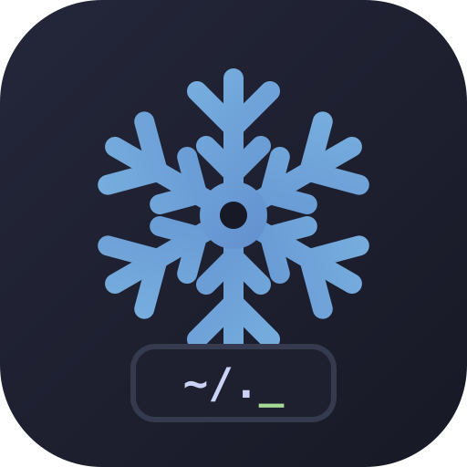

<p align="center">
  
</p>

# Chun's dotfiles

## Building the system

```bash
nh os switch . (-H chun-lappy)
```

## Cursors

The niri hosts use paid "Chunky" cursors by alllenski. They live in the private repo `gunbux/cursors`, which the `cursors` flake input fetches over SSH, so the machine needs SSH access to that repo.

Pick a cursor per host in its `home.nix`:

```nix
chun.cursor.theme = "mudkip"; # eevee (default), poliwag, mudkip or banana
```

The size defaults to 64 for the chunky cursors and 32 for Banana; set `chun.cursor.size` to change it.

To add a cursor:

1. Unzip the purchase's `*_linux.zip`.
2. Copy its `scm-*` folder into the `cursors` repo under a new name, such as `Pikachu-Chunky`, and push.
3. Add the name to `themes` in `modules/home/cursor.nix`.
4. Run `nix flake update cursors`.

## Running wireguard

If you're running wireguard on boot (wifi), wg0 will fail to autostart, so autostart is disabled. To start the vpn, run:

```nix
sudo systemctl start wg-quick-wg0
```
